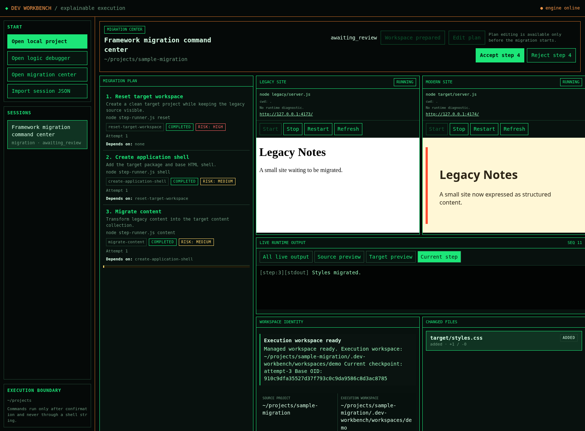
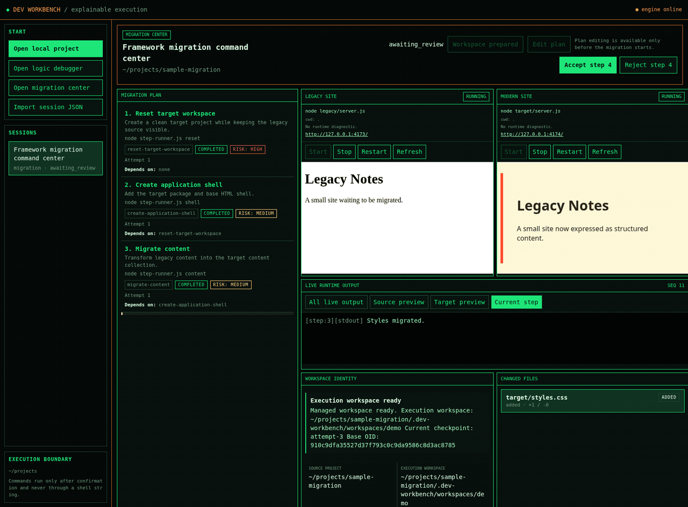
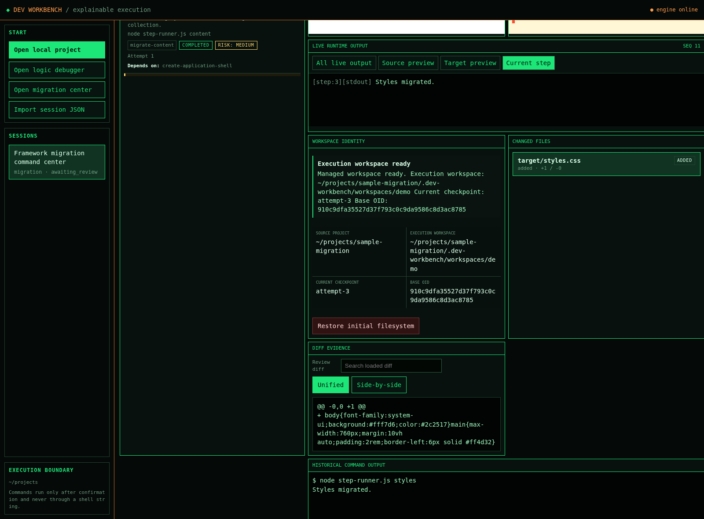
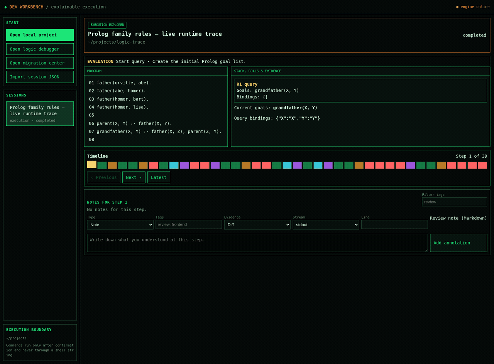
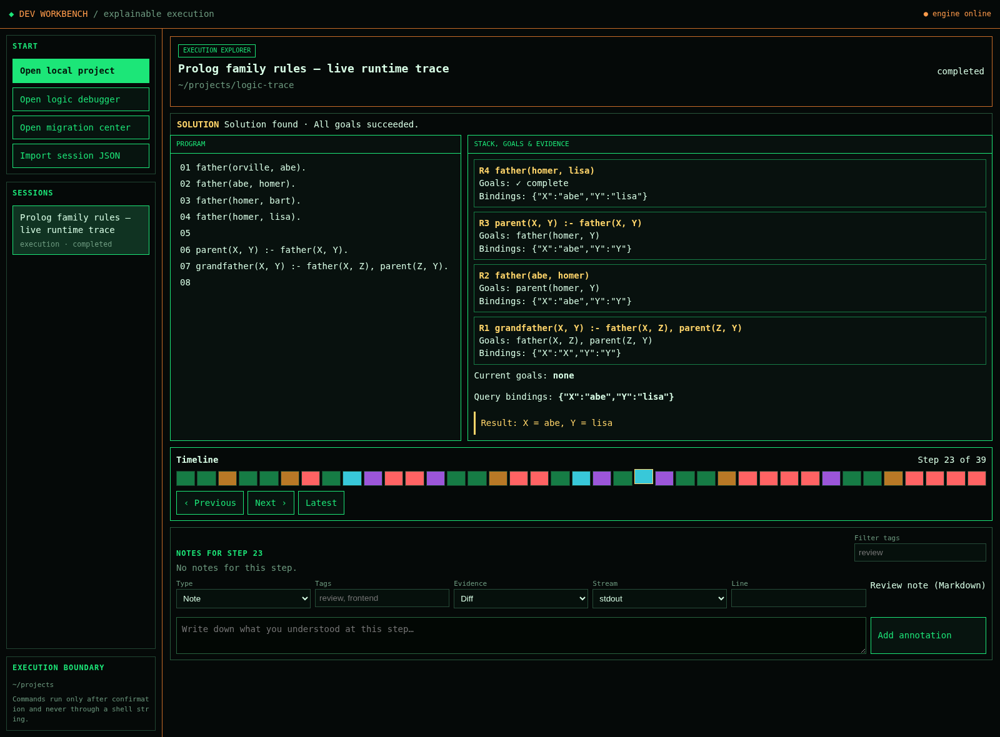

# Dev Workbench

**See every step. Review every change. Restore with confidence.**

Dev Workbench is a local-first workbench for understanding program execution and reviewing multi-step software migrations.

It brings execution traces, command output, file changes, live previews, and review decisions into one interactive timeline.

The demos below use the sample projects included in this repository.

<p align="center">
  
</p>

## See it in action

### Migration Center — review a migration before accepting it

Follow a real sample migration through managed Git worktrees, live source/target previews, command output, changed files, and a reviewable diff.





### Execution Explorer — replay program behavior

Step through a Prolog query and inspect goals, variable bindings, rule selection, solutions, and backtracking.





**What makes it different?**

- **Replay execution:** Step through structured traces and inspect source positions, stacks, variable bindings, branches, failures, and backtracking.
- **Review migrations:** Execute migration plans in managed Git worktrees, without running migration commands directly in your source working tree.
- **Inspect every change:** Review command output, file diffs, and live previews before accepting a step.
- **Recover safely:** Reject changes, retry from an exact baseline, or restore an accepted Git checkpoint.
- **Stay local:** Your projects and session data remain on your machine.

> Bring your own trace or migration plan. Dev Workbench is not a coding agent: it provides a reviewable execution environment for work produced by your scripts, tools, or AI agents.

## Why Dev Workbench?

AI-assisted development makes code changes faster, but understanding and reviewing those changes is still difficult.

When a migration or automated task finishes, you should be able to answer:

- What actually happened at each step?
- Which files changed, and why?
- What did the command produce?
- Can I reject one step without losing the previous work?
- Can I restore a known-good checkpoint?

Dev Workbench makes these questions part of the development workflow.

## Two Workbenches

### 1. Migration Center — Review changes step by step

Run a multi-step migration in a managed Git worktree.

1. Open an existing local project.
2. Prepare a migration workspace.
3. Review and confirm each command.
4. Inspect output, diffs, and live previews.
5. Accept or reject each step.
6. Retry from a verified baseline or restore an accepted checkpoint.

Your original working tree is not directly modified by migration commands.

### 2. Execution Explorer — Understand program behavior

Replay structured execution traces from interpreters, algorithms, rule engines, and agents.

- Step forward and backward through execution.
- Inspect source positions and intermediate states.
- Follow variable bindings and call stacks.
- Understand branching, failure, and backtracking.
- Add annotations and evidence bookmarks.

## Quick Start

Requirements: Node.js 22+ and Git for migration workspaces.

```bash
git clone https://github.com/wxcwyc/dev-workbench.git
cd dev-workbench
npm start
```

Open http://127.0.0.1:4177 in your browser.

No dependency installation or build step is required.

## Safety and Execution Boundaries

- Migration commands run in managed Git worktrees.
- Every command requires explicit confirmation.
- Changes enter a review gate before acceptance.
- Checkpoints support recovery of accepted work.
- The application binds to localhost by default.

Git worktree isolation is not an operating-system sandbox. Commands still run with the current user's permissions.

## Current Scope

- Execution Explorer currently includes a Prolog runtime adapter supporting a pure Horn clause subset.
- Other interpreters and tools can integrate through the trace adapter protocol.
- Migration plans are supplied by the user or external tools; native AI coding-agent orchestration is not currently provided.
- The current application is designed for trusted local environments, not public hosting.

## Contributing

Issues, feature suggestions, and pull requests are welcome.

If you use Dev Workbench in a real project, feedback about your workflow and review experience is especially valuable.

## License

MIT