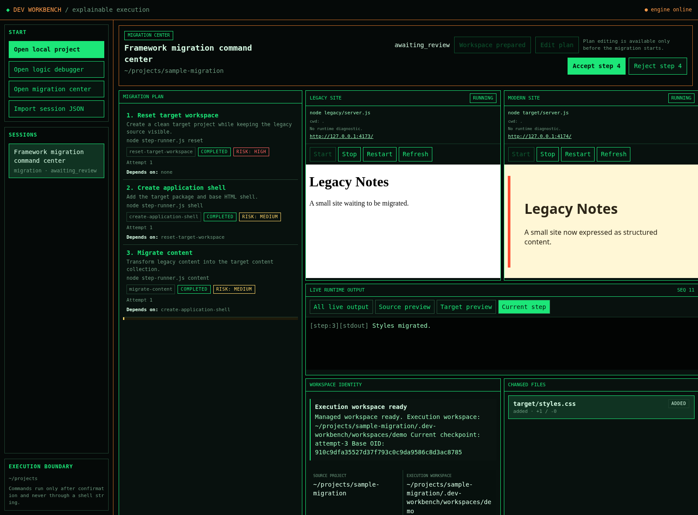
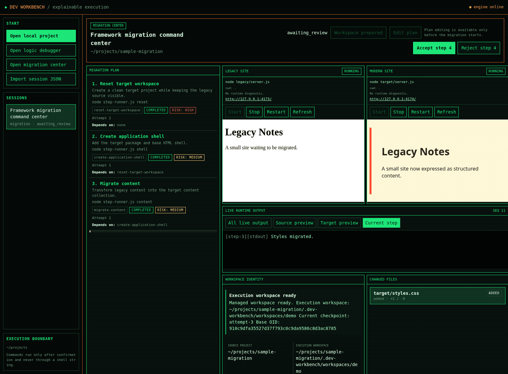
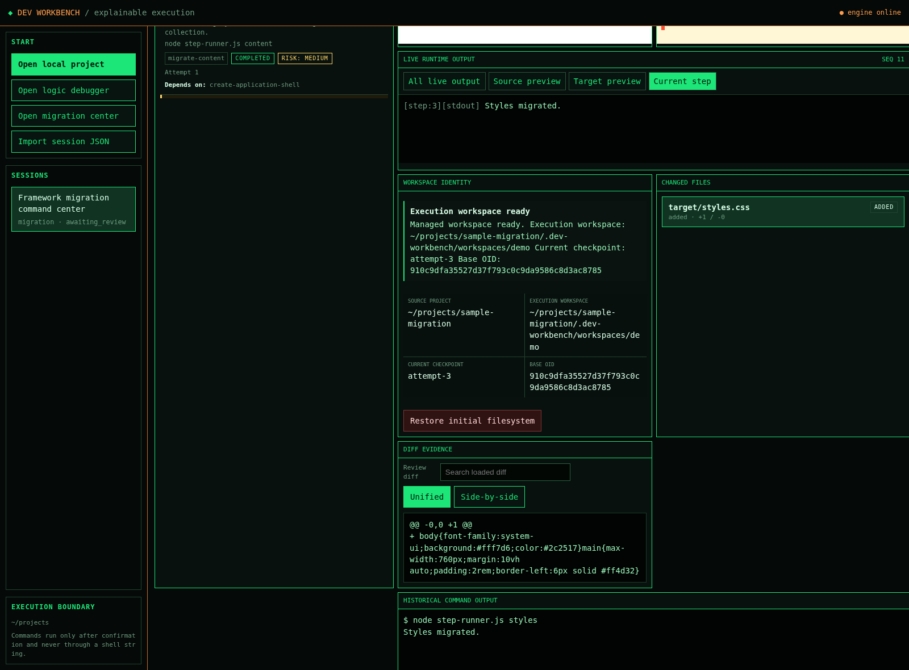
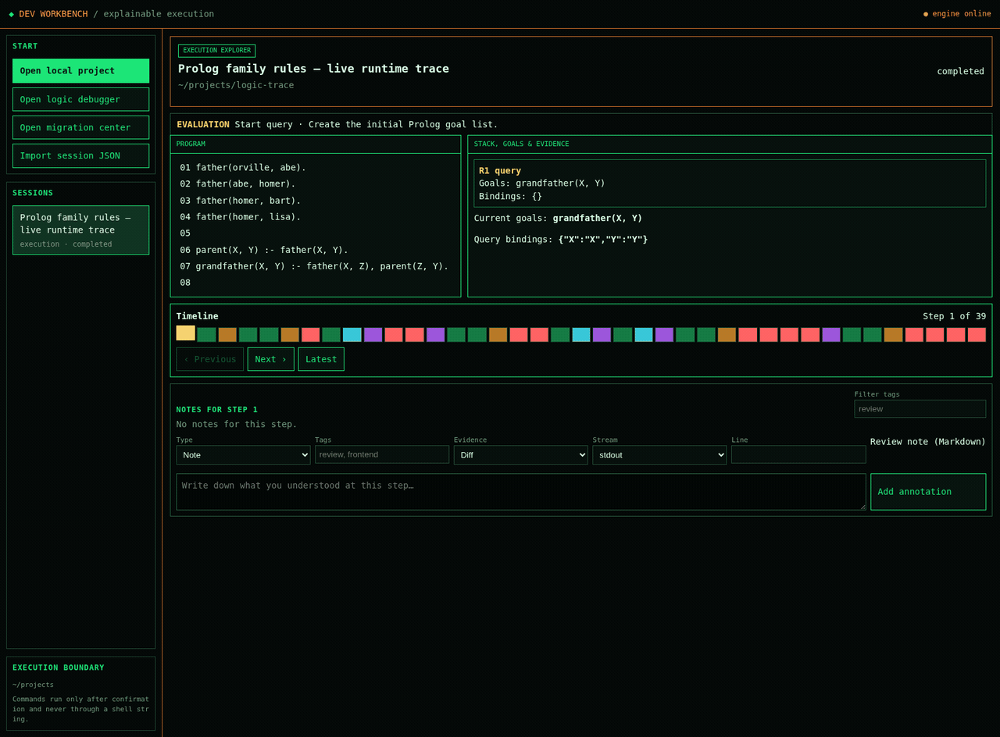
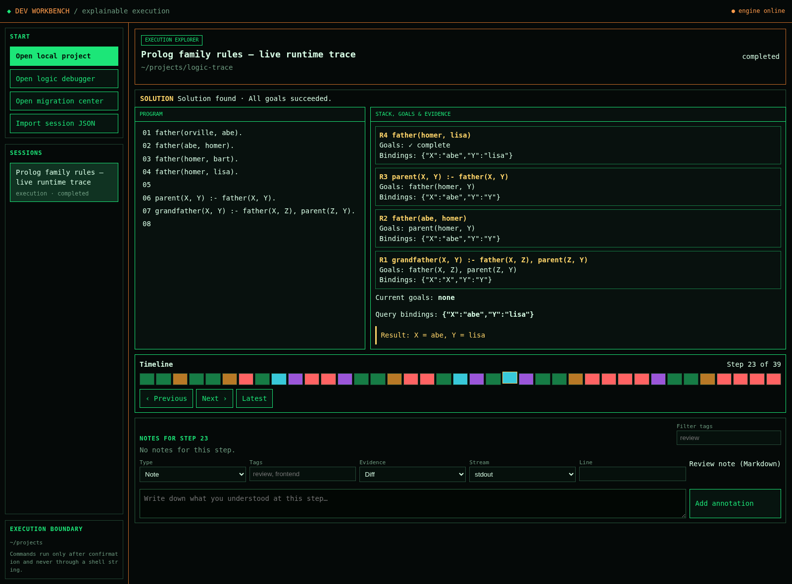

# Dev Workbench

**每一步都看得见，每一次改动都可审查，出错后可以恢复。**

Dev Workbench 是一款本地优先的开发工作台，帮助开发者理解程序执行过程，并逐步审查复杂的软件迁移。

它将执行轨迹、命令输出、文件变化、实时预览和审查记录整合到一条可交互的时间线上。

下方演示使用仓库内置的示例项目。

<p align="center">
  
</p>

## 实际运行演示

### Migration Center — 在接受前逐步审查迁移

通过一个真实运行的示例迁移，查看受管 Git Worktree、源/目标实时预览、命令输出、文件变更和可审查的 Diff。





### Execution Explorer — 回放程序执行过程

逐步运行 Prolog 查询，检查目标队列、变量绑定、规则选择、求解结果和回溯过程。





**它有什么不同？**

- **执行轨迹回放：** 逐步查看程序执行位置、调用栈、变量绑定、分支、失败和回溯。
- **逐步审查迁移：** 在受管 Git Worktree 中执行迁移计划，不直接修改原始工作树。
- **检查每次变更：** 在接受修改之前查看命令输出、文件 Diff 和实时预览。
- **失败后恢复：** 可以拒绝步骤、从精确基线重试，或恢复到已经接受的 Git 检查点。
- **本地优先：** 项目和会话数据保留在本机。

> 你可以导入自己或外部 AI Agent 生成的 Trace 和迁移计划。Dev Workbench 当前不是编码 Agent，而是为程序执行和代码变更提供可观察、可审查、可恢复的工作环境。

## 为什么需要 Dev Workbench？

AI 辅助开发让代码修改越来越快，但理解和审查这些修改仍然困难。

当自动化任务或大型迁移完成后，你应该能够回答：

- 每一步究竟执行了什么？
- 哪些文件发生了变化？
- 命令产生了什么结果？
- 能否拒绝某个步骤，而不丢失之前的工作？
- 能否恢复到一个已确认正确的检查点？

Dev Workbench 希望让这些问题成为开发过程的一部分。

## 两个工作台

### 1. Migration Center — 逐步审查代码迁移

在独立管理的 Git Worktree 中执行多步骤迁移。

1. 打开现有本地项目。
2. 准备迁移工作区。
3. 检查并确认每一条命令。
4. 查看命令输出、文件 Diff 和实时预览。
5. 接受或拒绝每个步骤。
6. 从已验证的基线重试，或恢复已接受的检查点。

迁移命令不会直接在原始工作树中执行。

### 2. Execution Explorer — 理解程序如何运行

回放解释器、算法、规则引擎和 Agent 的结构化执行轨迹。

- 前进、后退和逐步回放。
- 查看源码位置和中间状态。
- 跟踪变量绑定和调用栈。
- 理解分支、失败和回溯。
- 添加注释和证据书签。

## 快速开始

要求：Node.js 22+；迁移工作区需要 Git。

```bash
git clone https://github.com/wxcwyc/dev-workbench.git
cd dev-workbench
npm start
```

浏览器打开：

http://127.0.0.1:4177

无需安装 npm 依赖，也无需执行构建。

## 安全与执行边界

- 迁移命令运行在受管 Git Worktree 中。
- 每条命令都需要明确确认。
- 修改完成后进入审查流程。
- Git 检查点支持恢复已接受的工作。
- 应用默认只绑定本机 localhost。

注意：Git Worktree 隔离不等于操作系统沙箱，命令仍然具有当前用户的权限。

## 当前能力边界

- Execution Explorer 当前内置 Prolog Runtime Adapter，支持纯 Horn 子集。
- 其他解释器和工具可以通过 Trace Adapter 协议接入。
- 迁移计划由用户或外部工具提供，目前不提供原生 AI Coding Agent 编排。
- 当前版本面向可信本地环境，不适合直接作为公网服务部署。

## 参与项目

欢迎提交 Issue、功能建议和 Pull Request。

如果你在真实项目中使用 Dev Workbench，我们尤其希望了解你的执行、审查和恢复体验。

## License

MIT